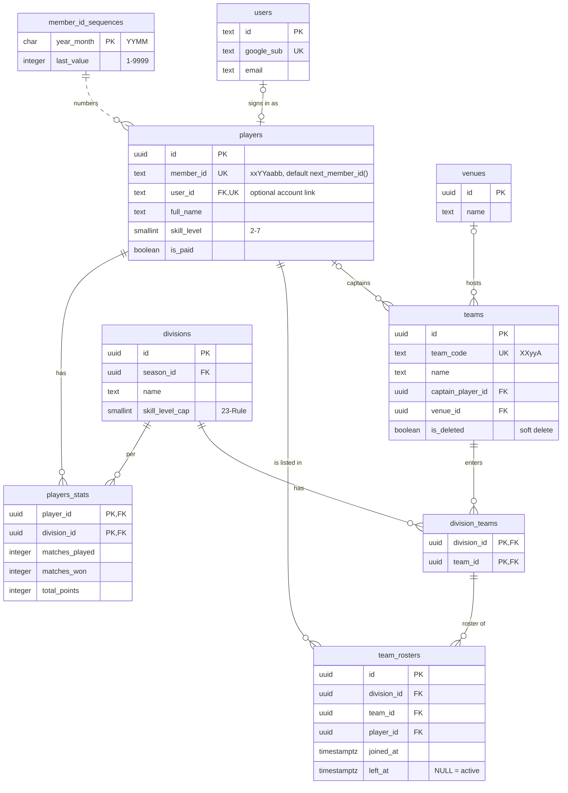
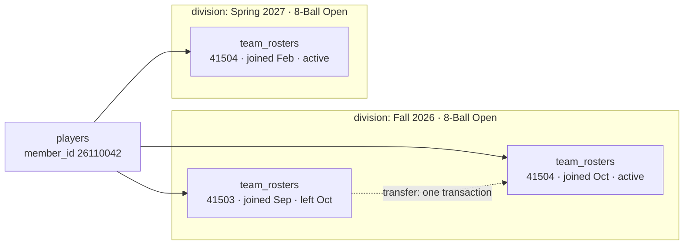
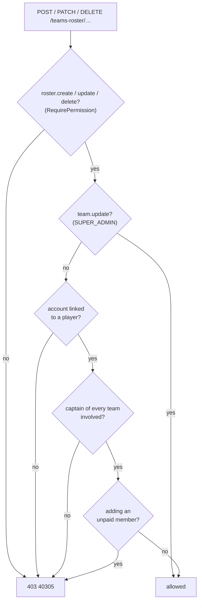

# Data model: teams, players and members

How a person, their membership and their teams relate. The schema is
`db/migrations/00001`–`00004`; the code that reads it is `internal/teams`.

---

## 1. Three identities, not one

| Word | Table | Identified by | Who has one |
|---|---|---|---|
| **Account** | `users` | `id`, Google `google_sub` | Anyone who signs in: operators, captains, some players |
| **Member** | `players` | `member_id` — `xxYYaabb`, e.g. `26110042` | Everyone registered to play, whether or not they ever sign in |
| **Team** | `teams` | `team_code` — `XXyyA`, e.g. `41503` | A team, for life |

Every table also has a UUID `id`. That is the key foreign keys and URLs use; the codes
are what people read on a scoresheet. `member_id` and `team_code` are each unique
across the whole league.

---

## 2. The relations

Reading it:

- **A team is permanent; a season is an entry.** `teams` holds the team once. Each season
  it plays, it gets a `division_teams` row — and only then can it have a roster or a fixture
  there (`team_rosters` and `team_matches` reference `division_teams`, not `teams`).
- **Deleting a team is soft first.** `DELETE /teams/{id}` sets `is_deleted` and closes its
  active roster entries; the row, its code and its history stay, so `41503` is never
  given to another team. `DELETE /teams/{id}/permanent` then removes it — never while it
  has a fixture.
- **A roster is history.** One `team_rosters` row per stint. Removing a player sets
  `left_at`; a transfer closes one row and opens another in the same transaction.
- **One active team per player per division**, enforced by the partial unique index
  `team_rosters (player_id, division_id) WHERE left_at IS NULL`. The same player can be on
  a 8-Ball team and a 9-Ball team at once — those are different divisions.
- **The captain is a member of the team.** `teams.captain_player_id` must be on the
  team's active roster when set, and cannot be removed or transferred while captain.
- **The account link is optional, both ways.** Most players never sign in; operators sign
  in without being players. A captain needs the link: it is how the service knows which
  team a signed-in user captains.

---

## 3. One member across two seasons

Member `26110042` registers in November 2026, plays Fall 2026 for `41503`, is transferred
to `41504` mid-season, and plays Spring 2027 for `41504` again.

`41504` has two `division_teams` rows (Fall, Spring) but is one `teams` row, so its name,
code and captain carry across seasons. The member's MW/MP on the roster screen come from
`players_stats` for that division, so each season starts from zero.

---

## 4. Who may change a roster

`roster.create/update/delete` say *what* a user may do. *Whose* roster is decided by the
service from existing permissions: a user who may update any team (`team.update`) may
change any roster; anyone else only the rosters of teams they captain. No extra
permission code is needed — see `.claude/rules/permissions.md`.

A transfer involves two teams, so a captain can only move players between teams they
captain both of; moving a player to another captain's team is an operator's job.
