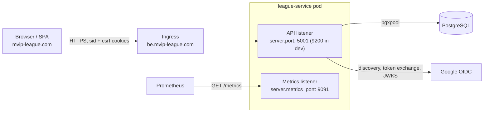
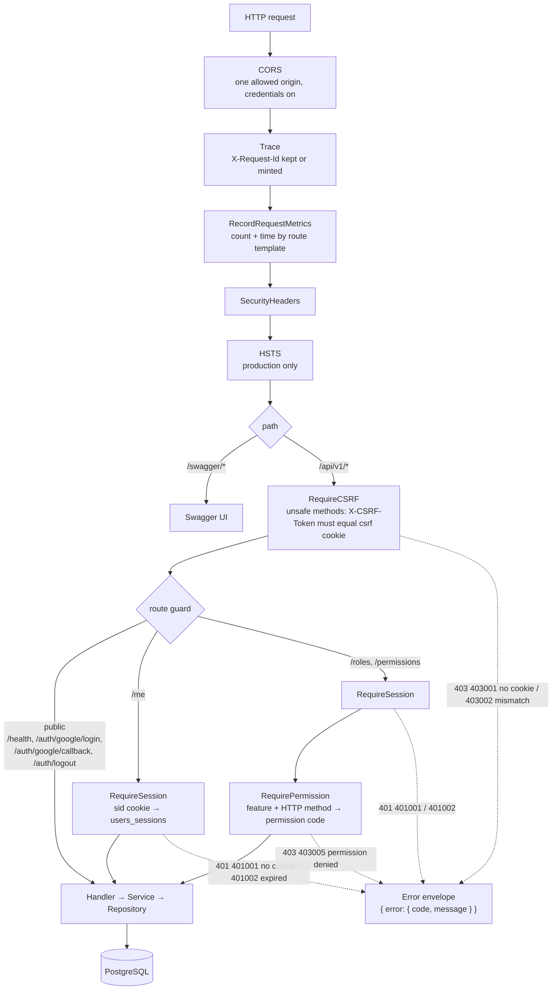
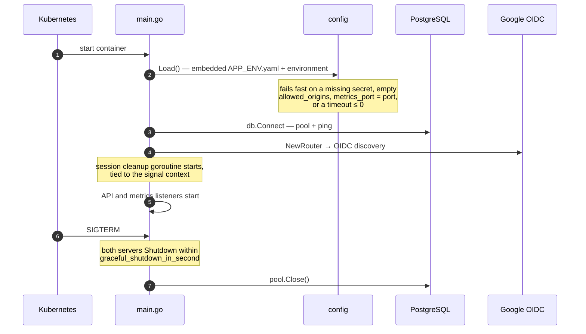
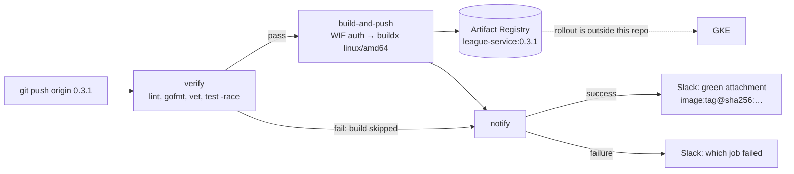

# Overview: how the service runs

The picture from the outside in. How one feature slice is layered inside is
[`architecture.md`](architecture.md); the Google login handshake is
[`internal/auth/README.md`](../internal/auth/README.md) §2.

---

## 1. What it talks to

- `/metrics` has its own port so the Service behind the public Ingress never exposes it;
  `config.Load()` refuses to start if the two ports are equal.
- The session lives in Postgres (`users_sessions`), so any number of pods can serve the same user.

---

## 2. A request through the API listener

`RequirePermission` maps the method to an action (`GET` → read, `POST` → create, …),
builds the code for the route's feature, and checks it against the codes the user holds
through `users_roles` → `roles_permissions`.

---

## 3. Startup and shutdown

Every step before the listeners start exits the process on failure, so a pod with a bad
config or no database never reports ready.

---

## 4. From a tag to an image

The tag is stamped into the binary and served back at `GET /api/v1/health` as `image`, so
what is running can be checked against what was pushed. Steps are in
[`workflow.md`](workflow.md) §10.
