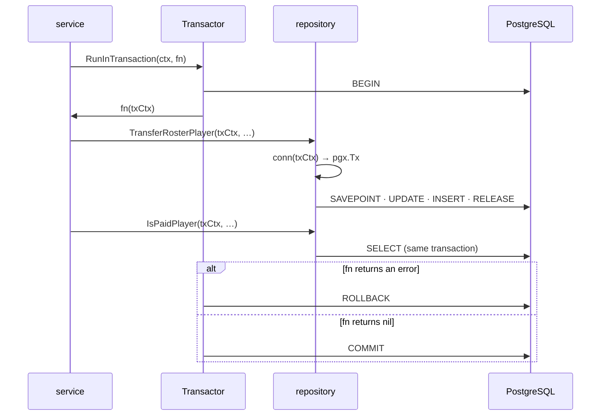

# Transactions across repository calls

How a service runs several repository calls as one unit that commits or rolls back
together. SQL rules live in [`.claude/rules/database.md`](../.claude/rules/database.md);
the layering in [`architecture.md`](architecture.md).

---

## 1. When you need it

Most writes do not. Reach for the narrowest tool that keeps the write atomic:

| Situation | Use | Example |
|---|---|---|
| One statement | a plain repository method | `teams.UpdateTeam` (one `UPDATE … COALESCE`) |
| Several statements, no business rule between them | one repository method with `pgx.BeginFunc` | `teams.CreateTeam`, `teams.TransferRosterPlayer` |
| A service decision **between** writes, or writes across repositories | `db.Transactor.RunInTransaction` | §3 below |

`RunInTransaction` is the edge case, not the default: it puts the transaction boundary in
the service, and every call inside it must remember to pass `txCtx` (§5).

---

## 2. The pieces

All in `internal/platform/db/transactor.go`.

| Name | Role |
|---|---|
| `Querier` | what a repository runs SQL on — `*pgxpool.Pool` and `pgx.Tx` both satisfy it |
| `Transactor.RunInTransaction(ctx, fn)` | begins a transaction, calls `fn(txCtx)`, commits on `nil`, rolls back otherwise |
| `ConnFromContext(ctx, pool)` | the `pgx.Tx` stored under `config.ContextKeyTransaction`, else `pool` |
| `repository.conn(ctx)` | each feature's one-line wrapper over `ConnFromContext`; every query goes through it |



The service never imports pgx: it holds a `db.Transactor` and a `context.Context`.

---

## 3. Example: a transfer a captain may make only for a paid player

Suppose the rule is checked after the transfer has been written, and must undo it when it
fails. `RunInTransaction` makes the two calls one unit:

```go
type service struct {
	repo             Repository
	permissionReader PermissionReader
	transactor       db.Transactor
	logger           *slog.Logger
}

func (s *service) TransferRosterPlayer(ctx context.Context, actorUserID string, params TransferRosterPlayerServiceParams) (*RosterPlayer, error) {
	// …validation, authorizeRosterWrite and rejectCaptain as today…

	err := s.transactor.RunInTransaction(ctx, func(txCtx context.Context) error {
		if err := s.repo.TransferRosterPlayer(txCtx, params); err != nil {
			return err // repository error → rollback
		}

		isPaid, err := s.repo.IsPaidPlayer(txCtx, params.From.PlayerID)
		if err != nil {
			return err
		}
		if !isPaid {
			// service rule → rollback: the closed and opened roster rows are both undone
			return handler.ErrorWithMessage(handler.CodePermissionDenied,
				"a captain can transfer only paid members; ask a league operator", nil)
		}
		return nil // commit
	})
	if err != nil {
		return nil, handler.MapFeatureError(err, teamErrorMappings)
	}

	player, err := s.repo.GetRosterPlayer(ctx, RosterEntryServiceParams{
		DivisionID: params.ToDivisionID,
		TeamID:     params.ToTeamID,
		PlayerID:   params.From.PlayerID,
	})
	return player, handler.MapFeatureError(err, teamErrorMappings)
}
```

Wire it at the composition root (`internal/platform/router/router.go`):

```go
transactor := db.NewTransactor(r.Pool)
teamService := teams.NewService(teams.NewRepo(r.Pool, r.Logger), permissionService, transactor, r.Logger)
```

> In the real code the paid check runs **before** the write, so no transaction is needed.
> Prefer that order whenever the rule can be checked first; use this pattern only when it
> cannot.

---

## 4. What rolls back

You never call `Rollback`. `RunInTransaction` uses `pgx.BeginFunc`, which defers a
rollback and commits only when `fn` returns `nil`.

| Inside `fn` | Outcome |
|---|---|
| `return err` — any non-nil error, from a repository or a service rule | rollback |
| a panic | rollback, then the panic reaches the recover middleware |
| request cancelled (client gone, timeout) | rollback — pgx aborts on a done `ctx` |
| `return nil` | commit |
| an error logged and swallowed, then `return nil` | **commit** |

`RunInTransaction` wraps with `%w`, so `MapFeatureError` still finds a sentinel such as
`ErrPlayerAlreadyInDivision` and the client sees the same code as without a transaction.

**Nesting.** A repository method that opens its own `pgx.BeginFunc` — `CreateTeam`,
`SoftDeleteTeam`, `TransferRosterPlayer` — starts from `r.conn(ctx)`. Inside a `txCtx`
that is the outer `pgx.Tx`, whose `Begin` is a `SAVEPOINT`, so the outer rollback undoes
it too. Outside one it is the pool, and behaves exactly as before.

---

## 5. Rules

1. **Inside `fn`, pass `txCtx`, never `ctx`.** A call given `ctx` takes another pooled
   connection, commits on its own and survives the rollback. Nothing fails loudly.
2. **No side effects inside `fn`.** An email, a Google call or a cache write is not undone
   by a rollback. Do it after `RunInTransaction` returns `nil`.
3. **Keep `fn` short.** The transaction holds a pooled connection and its row locks until
   it ends; no network calls, no sleeps.
4. **One goroutine.** A `pgx.Tx` is a single connection and is not safe for concurrent use;
   never hand `txCtx` to a goroutine.
5. **Every repository query goes through `r.conn(ctx)`.** A query on `r.pgPool` directly
   silently escapes the transaction.
6. **A transaction does not lock what you only read.** A check before the write
   (`rejectCaptain`, `IsPaidPlayer`) can change under you; put the condition in the
   write's SQL (as `insertRosterRow` does with `WHERE EXISTS`) or `SELECT … FOR UPDATE`.

---

## 6. Testing

- **Service unit tests** inject a fake that runs `fn` directly, so the repository mock
  sees the calls as usual:

  ```go
  type fakeTransactor struct{}

  func (fakeTransactor) RunInTransaction(ctx context.Context, fn func(txCtx context.Context) error) error {
  	return fn(ctx)
  }
  ```

- **Rollback itself** needs a real PostgreSQL: write inside `fn`, return an error, then
  assert the row is absent.

---

## References

- Three Dots Labs, [Database Transactions in Go with Layered
  Architecture](https://threedots.tech/post/database-transactions-in-go/) — compares
  transactions in the logic layer, in the repository, the `UpdateFn` pattern and the
  transaction provider; it calls passing the transaction through `Context` a workaround.
  This codebase defaults to transactions inside the repository and keeps
  `RunInTransaction` for the edge cases.
- [pgx v5](https://pkg.go.dev/github.com/jackc/pgx/v5) — `BeginFunc`, `Tx.Begin`
  (savepoints).
- The Go Blog, [Go Concurrency Patterns: Context](https://go.dev/blog/context) — what
  belongs in `context.WithValue`.
