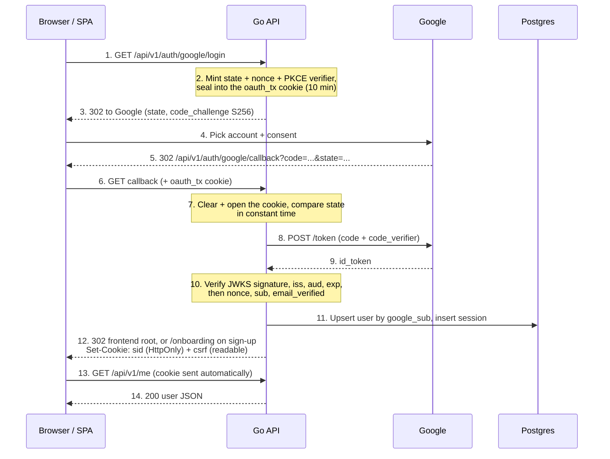
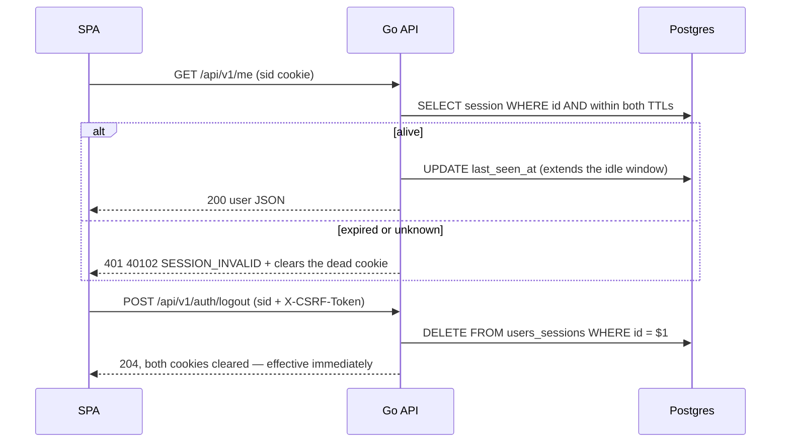

# Google Sign-in with Server-Side Sessions (Go)

> **Goal:** Users sign in / sign up with Google and stay signed in until they log out or go idle.
> **Stack:** Go, `gorilla/mux`, `golang.org/x/oauth2`, `github.com/coreos/go-oidc/v3`, Postgres (`pgx/v5`).
> **Standards:** OAuth 2.0 Authorization Code + PKCE (RFC 7636), OpenID Connect, RFC 9700 (OAuth Security BCP).
>
> **This file describes the backend as it actually is.** It replaced an earlier design based on JWT
> access tokens and rotating refresh tokens; nothing of that design remains. If you find a document
> describing `login_codes`, `refresh_tokens`, `Authorization: Bearer`, a `return_to` parameter or a
> `login_transactions` table, it is stale.

---

## 1. Overview

The browser goes through Google once. The callback sets an **HttpOnly session cookie** and redirects
into the SPA — there is no token handoff, no code in a URL, and nothing for the frontend to store.

- **Session**: a random 32-byte id in the `sid` cookie. The row in `users_sessions` *is* the session,
  so deleting it logs the user out immediately.
- **CSRF token**: a second cookie, `csrf`, deliberately readable by script. The SPA echoes it in
  `X-CSRF-Token` on every unsafe request.
- **Login transaction**: `state`, `nonce` and the PKCE verifier, sealed with AES-256-GCM into the
  short-lived `oauth_tx` cookie. The browser carries them but cannot **choose** them — integrity is
  the point, see §4. Nothing about an in-flight login touches the database.

A Google account whose `sub` is not in `users` is a **sign-up**; otherwise it is a **sign-in**. The
only difference the backend makes is the redirect target: a sign-up lands on `/onboarding`.

**There is no `return_to`.** The login route takes no parameters and the callback always sends the
browser to the frontend root (or `/onboarding`). Nothing in the sealed payload is a URL, so the open
redirect that a caller-supplied target invites cannot exist. Deep-linking back to where the user
started is the SPA's job — store it client-side before navigating away.

### Why cookies rather than Bearer tokens

A stateless JWT cannot be revoked: logout leaves an issued token valid until it expires. A session
row costs one indexed primary-key lookup per request and buys real logout, real revocation, and no
token for the frontend to mishandle. The price is CSRF, which Bearer tokens gave us for free — hence
the double-submit middleware.

### Code layout

```
internal/auth/
  services.go            Service: StartGoogleLogin, CompleteLogin, SessionUserID, GetUser, Logout,
                         StartSessionCleanup (the daily expiry sweep, a goroutine off ctx)
  services_google.go     GoogleAuth: OIDC discovery, AuthCodeURL, Identify (verified claims)
  login_transaction.go   seal/open the oauth_tx payload — two functions over *secret.Box
  repositories.go        Repository: the SQL, behind an interface so the service can be faked
  handlers.go            HTTP: redirects, /me, logout, failLogin
  handlers_cookie.go     the only place cookie attributes are chosen (name, path, domain, prefix)
  models.go              User, Session, LoginTransaction, GoogleIdentityParams
  model_services.go      LoginRedirect, CallbackInput, LoginResult (service boundary)
  model_handlers.go      UserResponse, MeResponse (the JSON shapes)
internal/common/token.go               RandomToken: 32 CSPRNG bytes, base64url
internal/secret/                       AES-256-GCM Box used to seal oauth_tx (and API keys in M2)
internal/platform/middleware/csrf.go   double-submit enforcement
internal/platform/handler/error.go     the numeric ErrorCode registry and the error envelope
```

Dependencies point inward: `router → auth → platform/{db,config,handler}` and `auth → {secret,
common}`. `auth` never imports `router`. `Repository` and `IdentityProvider` are interfaces so the
service is testable without a database or Google.

The sealer is deliberately **not** an interface: `*secret.Box` is the only implementation and the
tests use the real one, so the crypto is exercised rather than stubbed. Fake it only if a test ever
needs a seal failure.

`StartSessionCleanup` is a method on `Service` rather than a free function because it needs the same
TTLs the service already holds. The router calls it once at startup with the application context, so
the ticker loop stops on shutdown instead of outliving the process's own cancellation.

---

## 2. Sequence diagrams

### 2.1 Login (sign-in / sign-up)



### 2.2 Calling the API



---

## 3. API contract

Everything is mounted under `PrefixAPIV1` = `/api/v1` (`internal/platform/router/router.go`).

| Method | Path | Auth | Request | Success | Errors |
|---|---|---|---|---|---|
| GET | `/api/v1/auth/google/login` | – | – | 302 to Google, sets `oauth_tx` | 302 `{frontend}/login?error=server_error` |
| GET | `/api/v1/auth/google/callback` | `oauth_tx` cookie | `code`, `state` (from Google) | 302 frontend root, or `/onboarding` on sign-up; sets `sid` + `csrf` | 302 `…/login?error=cancelled\|login_failed\|server_error` |
| POST | `/api/v1/auth/logout` | `sid` + CSRF | – | 204, cookies cleared | 403 `40301`/`40302`, 500 `50001` |
| GET | `/api/v1/me` | `sid` | – | 200 `{data:{user:{id,email,name,avatarUrl}}}` | 401 `40101`/`40102`/`40103` |

Errors use the shared envelope from `internal/platform/handler/error.go`:
`{"error":{"code":"40102","message":"Your session has expired. Please sign in again."}}`. Success
responses are wrapped in `config.SuccessResponse` (`session_id`, `count`, `data`, `metadata`).

**Codes are 5-digit strings**, not slugs: the first three digits are the HTTP status, the last two
the case within it. The frontend switches on the string, so a code may be added but never reassigned.
The ones this package serves:

| Code | Reason (logs + docs) | Meaning |
|---|---|---|
| `40101` | `SESSION_COOKIE_ABSENT` | no `sid` cookie on the request |
| `40102` | `SESSION_INVALID` | `sid` present but `SessionUserID` refused it |
| `40103` | `USER_NOT_IN_CONTEXT` | handler ran without `middleware.RequireSession` populating the context |
| `40301` | `CSRF_COOKIE_ABSENT` | unsafe method with no `csrf` cookie |
| `40302` | `CSRF_TOKEN_MISMATCH` | header and cookie disagree |
| `50001` | `INTERNAL` | anything unclassified, including a failed logout |

The `reason` slug is developer-facing — it goes to the log line and the Swagger annotations, never
into a response body. The `message` is the browser-facing text and must never name an internal cause.

The `?error=` values on the login redirect are a **separate, frontend-facing set** — `cancelled`,
`login_failed`, `server_error` — not `handler.ErrorCode`s. The cause is logged, never put in the URL.

---

## 4. Credential model

| | Session (`sid`) | CSRF (`csrf`) | Login transaction (`oauth_tx`) |
|---|---|---|---|
| Format | 32 random bytes, base64url | 32 random bytes, base64url | AES-256-GCM sealed JSON, ~290 chars |
| Lifetime | `SESSION_TTL` absolute (12h) **and** `SESSION_IDLE_TTL` idle (30m) | same as the session | 10 minutes (`loginTxTTL`) |
| Server storage | `users_sessions` row (id stored raw) | none | none |
| Readable by JS | no (`HttpOnly`) | **yes, by design** | no (`HttpOnly`) — encryption is a side effect, not the goal |
| Revocation | `DELETE` the row — immediate | n/a | cleared at the callback |

**Rules**
- A fresh session id every login, never a reused one — this is what defeats session fixation.
- Both TTLs are enforced **in SQL** by `GetSession`, so an expired row can never resolve to a user.
- Session ids are stored raw rather than hashed: the cookie is `HttpOnly`, and a database dump
  already implies total compromise. Revisit if that stops holding.
- `ExpiresAt` inside `oauth_tx` is checked server-side, not trusted to the cookie's `Max-Age`.
- All three values come from the same `common.RandomToken` — 32 CSPRNG bytes, `base64url` so the
  value is safe in both a cookie and a URL.

### What sealing `oauth_tx` buys — and what it does not

**Integrity is the whole point.** Without the GCM tag the browser could rewrite its own cookie:
`ExpiresAt` out by a year, or a `state` of its choosing to pair with a stolen `code`. The tag makes
those values ours. The AAD constant (`loginTxAAD = "oauth_tx"`) domain-separates the blob, so a value
sealed in another context under the same master key cannot open here, and vice versa.

**Confidentiality adds almost nothing**, and earlier revisions of this file oversold it. The
verifier and nonce belong to the client's *own* login; a public SPA client would hold them in
JavaScript by design. Hiding them from the user who owns them protects nobody. AES-GCM is used
because `internal/secret` already exists for M2's API keys, so authenticated encryption costs
nothing over a bare MAC — not because the plaintext is sensitive.

**It does not stop an attacker planting a blob.** Anyone can hit the login route and receive a
validly sealed cookie for their own flow; nothing in the payload binds it to a browser. Delivering
it to a victim needs a cookie-forcing vulnerability, and the cookie prefix plus HTTPS are the
defences. The old `login_transactions` table had exactly the same hole — a valid transaction id in
the cookie was equally plantable — so this is not a regression from dropping it.

### Why state *and* PKCE *and* nonce

Three different jobs. `state` is checked by us (stops login CSRF, and still works when the user
cancels and no `code` comes back). The PKCE verifier is checked by **Google** during the exchange, so
a leaked or injected `code` cannot be redeemed. The `nonce` is checked inside the **ID token**, binding
that token to this login. `Identify` rejects an empty nonce on either side before comparing, because
two empty strings compare equal and would make the check vacuous.

---

## 5. Cookies

`handlers_cookie.go` is the only place cookie attributes are chosen. Name, `Path` and `Domain` are
all **derived from the base name** by one function each, so the `Set-Cookie` header, the prefix
decision and `clearCookie` cannot drift apart — cookie identity is `(name, domain, path)`, and
getting one of the three wrong on a delete expires a different cookie while the real one survives.

| Cookie | Path | Domain (production) | Lifetime | Attributes | Name in production |
|---|---|---|---|---|---|
| `sid` | `/` | host-locked | `SESSION_TTL` | `HttpOnly`, `Secure`*, `SameSite=Lax` | `__Host-sid` |
| `csrf` | `/` | registrable domain | `SESSION_TTL` | `Secure`*, `SameSite=Lax` — **not** `HttpOnly` | `__Secure-csrf` |
| `oauth_tx` | `/api/v1/auth/google` | host-locked | 10 min | `HttpOnly`, `Secure`*, `SameSite=Lax` | `__Secure-oauth_tx` |

\* `Secure` and the name prefix are both added when `APP_ENV=production`, and both read the same
`isSecure()` call, so they can never disagree. Outside production the names are bare and `Secure` is
off, because a browser refuses `Domain=localhost` and rejects `Secure` over plain HTTP.

**Each cookie gets the strongest prefix its attributes actually back.** A browser silently *discards*
a cookie whose attributes do not support its prefix (RFC 6265bis §4.1.3), so this cannot be one
hardcoded string: `__Host-` requires `Secure`, no `Domain` and `Path=/`, while `__Secure-` requires
only `Secure`. `oauth_tx` is path-scoped and `csrf` carries a `Domain`, so both can only ever be
`__Secure-`.

`csrf` is the one cookie widened to a `Domain`, resolved with `publicsuffix.EffectiveTLDPlusOne` so
`example.co.uk` cannot be truncated to a public suffix. The SPA has to *read* that value out of
`document.cookie`, and a cookie locked to the API's host is invisible to a page served from another
host — `be.` and `www.` are siblings, so only the shared parent covers both. `sid` and `oauth_tx`
stay host-locked: the browser already sends them on a destination-host match, so widening them would
buy nothing and would let any sibling subdomain read or overwrite the session.

`OAuthTxCookiePath` **must** stay a prefix of the mounted callback route. On a mismatch the browser
withholds the cookie, the callback fails with `no oauth_tx cookie`, and login is impossible — with no
compile error and nothing in the logs but a generic `login_failed` redirect. `TestOAuthTxCookiePath
CoversRoutes` in the router package asserts it (there, not here, because `router` imports `auth`).

`SameSite=Lax`, not `Strict`: Google's redirect back to the callback is a cross-site top-level
navigation, and a `Strict` cookie would not be sent on it. Lifetimes are written as `Max-Age`, not
`Expires`, so a skewed client clock cannot mis-expire a cookie.

### CSRF

`internal/platform/middleware/csrf.go` compares `X-CSRF-Token` against the `csrf` cookie with
`subtle.ConstantTimeCompare` on every unsafe method, and is wired on the whole `/api/v1` subrouter.
Safe methods (`GET`/`HEAD`/`OPTIONS`/`TRACE`) pass through, which is why the Google login routes need
no path exemption. The **resolved** cookie name is passed into the middleware via
`auth.CSRFCookieName(cfg)` rather than imported, so `platform` keeps no dependency on a feature
package — and so the middleware reads the same prefixed name the handler wrote.

A readable CSRF cookie is not a credential leak: it proves only that the request came from a page
able to read this origin's cookies, which a cross-site page cannot do.

---

## 6. Database

`db/migrations/00001_init.sql` is the whole schema for the service — these two tables are the auth
slice of it; everything else (leagues, divisions, teams, matches, roles) belongs to other packages.

```sql
CREATE TABLE users (
    id              TEXT        PRIMARY KEY DEFAULT uuid_generate_v4(),
    google_sub      TEXT        NOT NULL UNIQUE,  -- the ON CONFLICT target of the login upsert
    email           TEXT        NOT NULL,
    email_verified  BOOLEAN     NOT NULL DEFAULT false,
    name            TEXT        NOT NULL,
    avatar_url      TEXT        NOT NULL DEFAULT '',
    hd              TEXT,                         -- Google Workspace domain, absent for consumer accounts
    created_at      TIMESTAMPTZ NOT NULL DEFAULT now(),
    last_login_at   TIMESTAMPTZ NOT NULL DEFAULT now()
);

CREATE TABLE users_sessions (
    id            TEXT        PRIMARY KEY DEFAULT uuid_generate_v4(),
    user_id       TEXT        NOT NULL REFERENCES users (id) ON DELETE CASCADE,
    created_at    TIMESTAMPTZ NOT NULL DEFAULT now(),
    last_seen_at  TIMESTAMPTZ NOT NULL DEFAULT now()
);
CREATE INDEX sessions_user_id_idx ON users_sessions (user_id);
```

`users.id` is `TEXT` holding a `uuid_generate_v4()` value, which is why `auth.User.ID` and
`auth.Session.UserID` are Go strings. Every FK into `users` elsewhere in the schema is therefore
`TEXT` too — a `BIGINT` one cannot even be created (`incompatible types: bigint and text`). The
column default exists for hand-written rows and seeds; both ids this package stores are generated in
Go, because a session id must come from a CSPRNG the application controls.

| Repository method | SQL |
|---|---|
| `UpsertGoogleIdentity` | `INSERT … ON CONFLICT (google_sub) DO UPDATE … RETURNING …, (xmax = 0)` — one round trip; `xmax = 0` means this statement inserted the row, i.e. a sign-up |
| `GetUserByID` | `SELECT … WHERE id = $1` |
| `CreateSession` | `INSERT INTO users_sessions …` |
| `GetSession` | `SELECT … WHERE id = $1 AND created_at > $2 AND last_seen_at > $3` — both TTLs |
| `UpdateSessionLastSeenAt` | `UPDATE users_sessions SET last_seen_at = now()` |
| `ReplaceSession` | sign-in; replaces the previous device's session (one per user) |
| `DeleteSession` / `DeleteUserSessions` | logout one device / all devices |
| `DeleteExpiredSessions` | `DELETE … WHERE created_at <= $1 OR last_seen_at <= $2` (startup + every 24h) |

The TTL cutoffs are parameters, not SQL literals: the service computes them from config and the SQL
decides what is still alive. `UpsertGoogleIdentity` is the one query with a hand-written `Scan` list,
because `(xmax = 0)` has no field on `User` and `pgx.RowToStructByName` rejects the extra column —
that list is kept in `userColumns` order, adjacent to the constant.

A missing row is a sentinel, not a wrapped driver error: `GetSession` returns `ErrNoSession` and
`GetUserByID` returns `ErrNoUser`, so a caller can tell "not there" from "database is down".

**A user is only ever looked up by `google_sub`, never by email.** Resolving by email would let anyone
who can obtain a Google account at a known address take over the existing account. There is no
`user_identities` table: it was a join table for a one-to-one relationship, and the protection comes
from the lookup key, not from the table split. Adding a second sign-in provider later means
re-introducing it with a backfill from `google_sub`.

---

## 7. Error handling

| Situation | Behaviour |
|---|---|
| `oauth_tx` missing, forged, tampered, foreign or expired | 302 `/login?error=login_failed` — fails closed, **no** token exchange |
| User cancels at Google (`?error=` on the callback) | 302 `/login?error=cancelled` |
| Callback arrives without `code` or `state` | 302 `/login?error=login_failed`, before contacting Google |
| State mismatch | 302 `/login?error=login_failed` (`ErrLoginRejected`), before contacting Google |
| Exchange failure, bad `id_token`, nonce missing or mismatched, no `sub`, `email_verified=false` | 302 `/login?error=login_failed` |
| DB error, or a failed CSRF token mint, during the callback | 302 `/login?error=server_error` |
| Missing `sid` | 401 `40101 SESSION_COOKIE_ABSENT` |
| Unknown or expired `sid` | 401 `40102 SESSION_INVALID`, dead cookie cleared |
| Missing or mismatched CSRF token | 403 `40301` / `40302` |
| Logout fails in the database | 500 `50001 INTERNAL`, cookies left in place |

`ErrLoginRejected` is the single sentinel for every unacceptable Google round trip, which is what
lets `CallbackLogin` separate "their fault" (`login_failed`) from "our fault" (`server_error`) with
one `errors.Is`. Anything that is not an `*APIError` is served as `50001`, so an unclassified failure
cannot leak its text. Every handler in this package sets `Cache-Control: no-store` on its own
responses, including the failure redirects; `middleware.RequireSession`'s 401s do not, because they are
served straight through `ReturnWithError`.

Log the cause on the server; never return an internal error, and never log a cookie value, sealed
blob, authorization code or ID token. `ReturnWithError` logs method, path, status, code, reason and
cause — deliberately not the user-facing message and nothing from the request body.

---

## 8. Frontend contract

1. "Sign in with Google" is a plain link to `GET {API}/api/v1/auth/google/login` — a full-page
   navigation, not `fetch`. It takes no parameters.
2. There is **no** callback page to write and nothing to store. The callback lands on the frontend
   root with the cookies already set, or on `/onboarding` when the account was just created — so
   `/onboarding` must exist as a route.
3. To return the user to where they started, save that yourself before navigating to the login link.
   The backend will not carry it.
4. Every request needs `credentials: 'include'` (the API may be on another origin).
5. On every unsafe request, read the `csrf` cookie and send it as `X-CSRF-Token`. In production the
   cookie is named `__Secure-csrf`.
6. Page `/login` shows a message for `error=cancelled`, `login_failed`, `server_error`.
7. On a 401 (`40101`, `40102`, `40103`), drop client state and route to `/login` — there is no
   refresh step to attempt.
8. Logout: `POST /api/v1/auth/logout` with the CSRF header; the server clears both cookies.

---

## 9. Configuration

Config is the **embedded YAML for `APP_ENV`** (`development|staging|production.yaml`, compiled in via
`go:embed`) **overlaid with environment variables** for anything secret or per-machine. Both halves
matter — looking for a value in `os.Getenv` alone will mislead you.

From the YAML (`internal/platform/config/`):

| Key | Example (development) | Notes |
|---|---|---|
| `auth.google_oauth_redirect_url` | `http://localhost:9200/api/v1/auth/google/callback` | Must match the Google Console entry exactly; required, validated at load |
| `app_base_url.frontend` | `http://localhost:5174` | Redirect target and the source of the cookie `Domain` |
| `domains.allowed_origins` | `http://localhost:*` | The CORS trust list; every entry may read an authenticated response. Required — an empty list is refused at startup |
| `server.*`, `logger.*`, `database.*` pool sizing | – | Non-secret operational knobs |

From the environment:

| Variable | Example | Notes |
|---|---|---|
| `APP_ENV` | `development` | Picks the embedded YAML; `production` is what turns on `Secure`, cookie prefixes and HSTS |
| `GOOGLE_OAUTH_CLIENT_ID` / `_SECRET` | – | Required; the code exchange is server-side |
| `ENCRYPTION_KEY` | `ZXhhbXBsZS1rZXktZG8tbm90LXVzZS1pbi1wcm9kISE=` | Required. **Standard** base64 (`+/=`, not base64url) of **exactly 32 bytes** → always 44 chars ending in `=`. Generate with `openssl rand -base64 32`; the example is a placeholder, not a key |
| `ENCRYPTION_KEY_VERSION` | `1` | Integer **1–255** — stored as a single byte prefixed to every sealed value, which is the hook for key rotation |
| `SESSION_TTL` | `12h` | Absolute lifetime (default 12h) |
| `SESSION_IDLE_TTL` | `30m` | Idle window (default 30m), must not exceed `SESSION_TTL` |
| `BASE_URL` | `http://localhost:9200` | Public API origin |
| `PORT` | `9200` | Wins over `server.port`; how docker-compose pins it |
| `DATABASE_URL`, or `DB_HOST`/`DB_PORT`/`DB_USER`/`DB_PASSWORD`/`DB_NAME`/`DB_SSLMODE` | – | `DATABASE_URL` wins when set |

`config.Load()` fails fast if either OAuth credential, the redirect URL or `ENCRYPTION_KEY` is
missing, rather than 302-ing to Google with an empty client id, and it rejects a `SESSION_IDLE_TTL`
longer than `SESSION_TTL` — a combination that would make the idle window dead code. `envIntOr` and
`durationOr` report a malformed value instead of falling back to the default, so a typo in
`ENCRYPTION_KEY_VERSION` or `SESSION_TTL` stops the process rather than silently changing behaviour.
`NewBox` then rejects a key of the wrong length at startup — AES-256 is pinned, so there is no weaker
mode to fall back to.

⚠️ **`-base64 48` is the trap.** The deleted `JWT_SECRET` wanted ≥32 bytes of entropy and the old
docs suggested 48; copying that here fails with `key must decode to 32 bytes, got 48`.

CORS is configured once in `cmd/server/main.go`, from `domains.allowed_origins` in the environment's
YAML, with `AllowCredentials: true` — the browser sends a cookie cross-origin only when both are
set. `X-CSRF-Token` is in `config.AllowHeadersAPI`, so a cross-site page cannot set it without
surviving a preflight.

**Every entry in that list can read an authenticated response**, so it is a trust list, not a
convenience list. Staging and production name their origins exactly; only development carries the
`localhost` wildcards, and no environment carries `https://*.vercel.app` — a wildcard there would
let any site on that host read a signed-in user's data. Name preview deployments individually.
`config.Load()` rejects an empty list, because `rs/cors` reads empty `AllowedOrigins` as *every*
origin, which with credentials enabled is the one failure mode that must not be silent.

Google Cloud Console: Web application client, **Authorized redirect URI** must equal
`auth.google_oauth_redirect_url`. Scopes stay non-sensitive (`openid`, `email`, `profile`), the app
stays in Testing with team accounts as test users, no logo during the MVP.

---

## 10. Security checklist

- [x] New random `state`, `nonce` and PKCE verifier per login, all from one CSPRNG helper
- [x] `state` compared with `subtle.ConstantTimeCompare`
- [x] `oauth_tx` integrity-protected (AES-256-GCM tag) with an AAD domain separator naming its
      context, so a blob from one context cannot be opened in another; expiry checked server-side
- [x] ID token verified against the JWKS: signature, `iss`, `aud`, `exp`, then `nonce` and `sub`
- [x] `email_verified` required; users keyed by `google_sub`, never by email
- [x] No credential ever travels in a URL, and no caller-supplied redirect target exists at all
- [x] Fresh session id per login (session fixation)
- [x] Session cookie `HttpOnly`; `Secure` plus the strongest prefix each cookie's attributes back,
      in production
- [x] Dual TTL enforced in SQL; logout deletes the row and takes effect immediately
- [x] CSRF double-submit on every unsafe `/api/v1` method, constant-time compare
- [x] CORS origins are named per environment, no wildcards outside development, and an empty
      list is rejected at startup rather than falling open to every origin
- [x] Security headers on every response; HSTS in production; `no-store` on every auth handler's response
- [x] No cookies, blobs, codes or tokens in logs; no internal errors in responses
- [ ] **No Google Workspace (`hd`) restriction.** Any Google account with a verified email can sign
      up. `hd` is captured and stored, but nothing reads it — see §11.

---

## 11. Known trade-offs

- **`hd` is stored but never enforced.** `GoogleClaims` carries it and the upsert writes it, yet no
  code compares it to an allowed domain, so there is no `forbidden` login outcome and no
  `ErrDomainNotAllowed`. If sign-up must be limited to a Workspace domain, that check belongs in
  `CompleteLogin` against the live claim, with its own `?error=` value — the stored column is for
  reporting, not for authorization.
- **Replay of the callback is not caught by us.** The old `login_transactions` table made a callback
  single-use via `DELETE … RETURNING`. With a sealed cookie we clear it, but cannot prove it was not
  kept, so a replay reaches Google — where the authorization code is already spent and the exchange
  fails. No test pins this; the package's only tests cover cookie attributes.
- **Neither this design nor the table it replaced resists cookie-forcing.** An attacker who can set
  the victim's `oauth_tx` can complete a login as *their own* Google account in the victim's browser
  (login CSRF). Prefixed cookies and HTTPS are what prevent the delivery; no payload format helps.
- **`middleware.RequireSession` collapses every `SessionUserID` failure into `40102`** and clears the cookie, so a
  database outage signs users out and reads to the SPA as an expired session. The sentinels needed to
  tell those apart (`ErrNoSession`, `ErrNoUser`) already exist — map them when it matters.
- **A session read costs a query per authenticated request.** That read is exactly what makes logout
  and revocation work.
- `UpdateSessionLastSeenAt` writes on every authenticated request. Fine at this scale; batch or
  sample it if the write rate ever matters. It also runs *after* the user lookup, so a failed touch
  fails the whole request even though the session was valid.
- An absolute `SESSION_TTL` of 12h means an active user is signed out once a day. Raise it, or add
  re-authentication for sensitive actions, if that becomes annoying.
- The expiry sweep is housekeeping only — `GetSession` already refuses expired rows — and it runs in
  one goroutine per process, so several replicas will each sweep. The `DELETE` is idempotent, so the
  duplicate work is wasted, not harmful.
